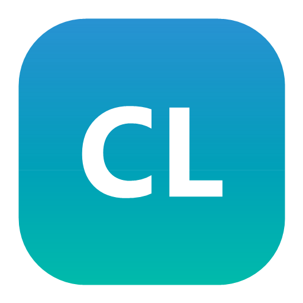
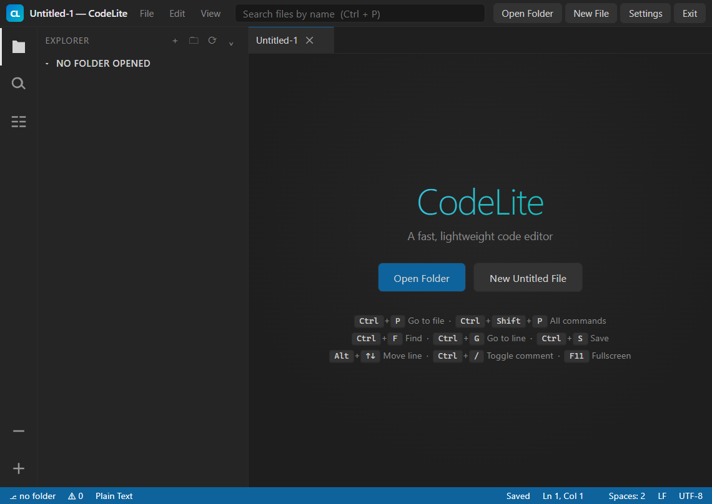
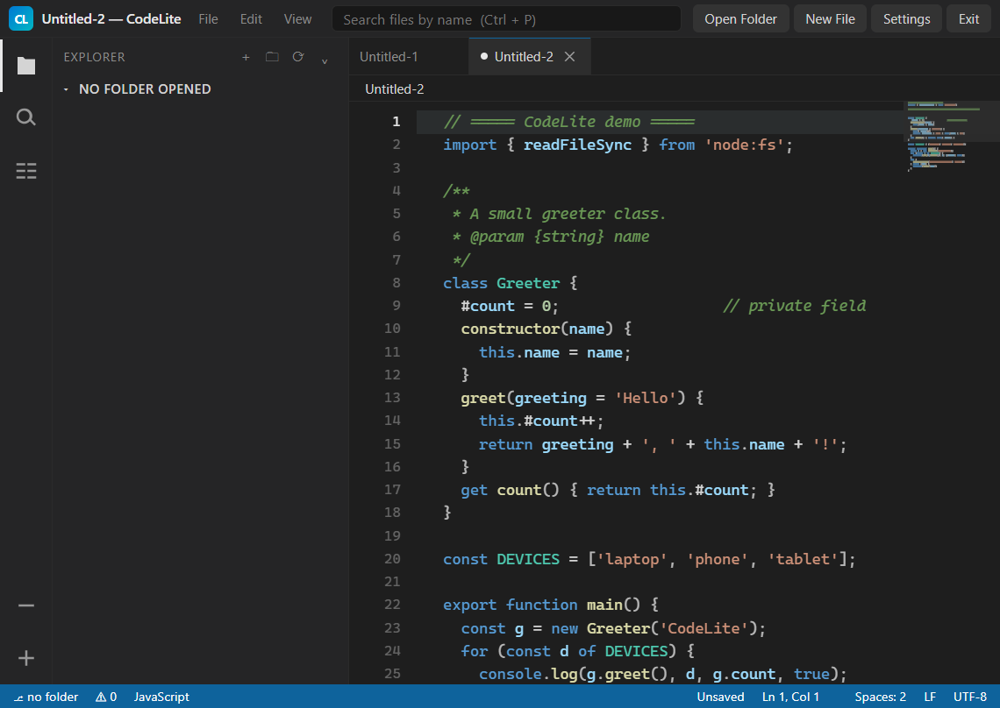
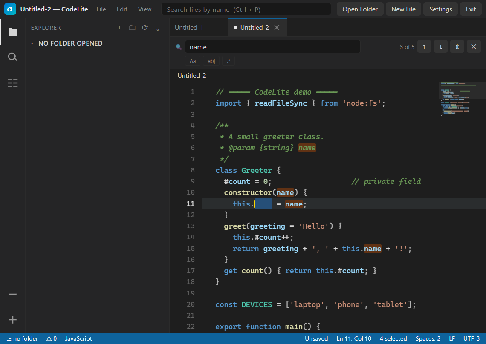
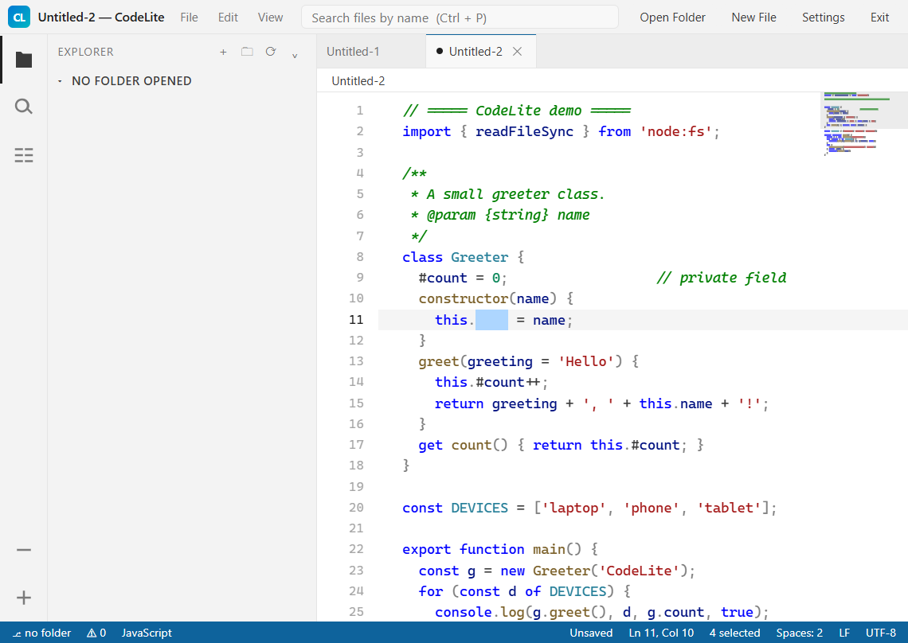

<div align="center">



# CodeLite

**A lightweight, fully offline code editor for Windows.**

No telemetry. No accounts. No tracking. Under 100 KB of code.

[](https://learn.microsoft.com/en-us/windows/)
[]()
[](docs/CHANGELOG.md)

**[💾 Download the installer](https://abhijeet-kumar-prajapati.github.io/CODELITE-SOFTWARE-PC/#download)** · [**User guide**](docs/USER-GUIDE-EN.txt)

| | |
|---|---|
| <a href="https://github.com/Abhijeet-Kumar-Prajapati/CODELITE-SOFTWARE-PC/releases/latest/download/CodeLite-Setup-1.0.0.exe"></a> | <a href="https://github.com/Abhijeet-Kumar-Prajapati/CODELITE-SOFTWARE-PC/releases"></a> |
| **`CodeLite-Setup-1.0.0.exe`** &middot; 20.7 MB &middot; Windows 10/11 &middot; per-user, no admin rights | Every version, with changelogs |

> The download link above always points at the newest release, so it never goes stale.

</div>

---

## 📥 Download

**No build step, no package manager, no setup.** Download the installer and start editing.

| File | Size | How to use |
|---|---|---|
| **`CodeLite-Setup-1.0.0.exe`** | 20.7 MB | Double click it, choose your shortcuts, done. Installs per-user, so it never asks for administrator rights. |

- **Direct download** — <https://github.com/Abhijeet-Kumar-Prajapati/CODELITE-SOFTWARE-PC/releases/latest/download/CodeLite-Setup-1.0.0.exe>
- **Release page** — <https://github.com/Abhijeet-Kumar-Prajapati/CODELITE-SOFTWARE-PC/releases>
- **Download page** — <https://abhijeet-kumar-prajapati.github.io/CODELITE-SOFTWARE-PC/#download>

Once installed it launches from the Start Menu or a Desktop shortcut, and puts
its own icon and app window on your machine. It needs Edge or Chrome, which
Windows 10 and 11 already ship with.

---

## What it looks like

**Welcome screen**



**Editing with syntax highlighting and the minimap**



**Find and replace, with every match highlighted live**



**Light+ theme**



---

## Why CodeLite?

Most editors are either enormous or they are web toys that cannot touch your
files. CodeLite sits in between: a real editor that installs like an app,
starts in about a second, and never phones home.

| | |
|---|---|
| **Install size** | ~2 MB |
| **First launch** | ~1 second |
| **Source size** | ~120 KB |
| **Network calls** | none, ever |
| **Telemetry** | none |
| **Administrator rights** | not needed |

---

## Features

### Editing
- Syntax highlighting for **30+ languages**
- Line numbers with current-line highlight
- Minimap with a click-to-jump viewport indicator
- Automatic indentation on <kbd>Enter</kbd>
- Automatic closing and selection-wrapping for `(` `{` `[` `"` `` ` ``
- Toggle line comment (<kbd>Ctrl</kbd>+<kbd>/</kbd>)
- Delete line, duplicate line, move line up/down
- Smart <kbd>Home</kbd> and expand selection (<kbd>Ctrl</kbd>+<kbd>L</kbd>)
- Goto line/column (<kbd>Ctrl</kbd>+<kbd>G</kbd>)
- Multiple tabs with unsaved-change indicators
- Tab size, font size and word wrap are configurable

### Finding
- Find and replace with **regex**, match-case and whole-word modes
- Every match highlighted in the editor as you type
- Project-wide search with click-to-jump results
- Quick open by filename with fuzzy matching (<kbd>Ctrl</kbd>+<kbd>P</kbd>)
- Command palette with 19 commands (<kbd>Ctrl</kbd>+<kbd>Shift</kbd>+<kbd>P</kbd>)
- Outline view of functions, classes and headings

### Files
- Folder tree explorer with **lazy loading** (huge projects open instantly)
- Create file, create folder, rename, delete
- `.git`, `node_modules` and `__pycache__` skipped automatically
- Breadcrumbs for the active file
- Real read/write access through the File System Access API

### Interface
- VS Code inspired **Dark+**, **Light+** and **High Contrast** themes
- Settings remembered between sessions

---

## Supported languages

JavaScript · TypeScript · JSX/TSX · Python · Java · C · C++ · C# · Go · Rust ·
PHP · Ruby · SQL · HTML · CSS · SCSS · Less · JSON · YAML · TOML · XML · SVG ·
Markdown · Shell/Bash · PowerShell · Batch · Lua · Dart · Swift · Kotlin ·
Perl · R · Dockerfile · INI

Anything else still opens as plain text.

---

## Keyboard shortcuts

| Shortcut | Action |
|---|---|
| <kbd>Ctrl</kbd>+<kbd>P</kbd> | Go to file |
| <kbd>Ctrl</kbd>+<kbd>Shift</kbd>+<kbd>P</kbd> | Command palette |
| <kbd>Ctrl</kbd>+<kbd>S</kbd> | Save |
| <kbd>Ctrl</kbd>+<kbd>Shift</kbd>+<kbd>S</kbd> | Save as |
| <kbd>Ctrl</kbd>+<kbd>F</kbd> / <kbd>Ctrl</kbd>+<kbd>H</kbd> | Find / replace |
| <kbd>Ctrl</kbd>+<kbd>G</kbd> | Go to line |
| <kbd>Ctrl</kbd>+<kbd>B</kbd> | Toggle sidebar |
| <kbd>Ctrl</kbd>+<kbd>K</kbd> <kbd>Ctrl</kbd>+<kbd>O</kbd> | Open folder |
| <kbd>Ctrl</kbd>+<kbd>/</kbd> | Toggle comment |
| <kbd>Ctrl</kbd>+<kbd>Shift</kbd>+<kbd>K</kbd> | Delete line |
| <kbd>Ctrl</kbd>+<kbd>D</kbd> | Duplicate line |
| <kbd>Alt</kbd>+<kbd>↑</kbd>/<kbd>↓</kbd> | Move line |
| <kbd>Alt</kbd>+<kbd>Z</kbd> | Toggle word wrap |
| <kbd>Ctrl</kbd>+<kbd>=</kbd> / <kbd>-</kbd> | Font size |
| <kbd>F11</kbd> | Full screen |

Full list in the [user guide](docs/USER-GUIDE-EN.txt).

---

## Install

Download **`CodeLite-Setup-1.0.0.exe`** from the releases page and run it.

The installer needs no administrator rights. It installs to
`%LOCALAPPDATA%\Programs\CodeLite` and creates Start Menu and Desktop
shortcuts. Uninstall from **Settings → Apps → Installed apps**.

> The installer is not yet code-signed, so Windows SmartScreen may show a
> warning the first time. Click **More info → Run anyway**.

---

## How it works

Browsers only let a page read your files when it is served from a *secure
origin*. CodeLite therefore starts a tiny local server that binds to
`127.0.0.1` only, and the interface opens in an app window inside Edge or
Chrome.

That server:

- never listens on a public interface,
- is not reachable from any other machine,
- validates every request path against the installation directory,
- shuts down as soon as you close the app.

The editor itself is plain HTML, CSS and JavaScript. There is no build step
and no runtime dependency beyond a browser you already have.

---

## Project layout

```
CodeLite/
├── src/                       the application
│   ├── START CodeLite.bat     launcher (starts server + app window)
│   ├── STOP CodeLite.bat      stops the local server
│   ├── CodeLiteServer.ps1     minimal localhost HTTP server
│   ├── build/                 application icon
│   └── app/
│       ├── index.html
│       ├── css/               base + editor styles and themes
│       └── js/
│           ├── highlight.js   tokenizer and HTML renderer
│           ├── editor.js      editor core, caret, indentation, find
│           ├── minimap.js     code minimap
│           ├── explorer.js    folder tree over the File System Access API
│           └── app.js         tabs, commands, wiring
├── installer/
│   └── CodeLite.iss           Inno Setup script
├── scripts/
│   ├── build-installer.ps1    compiles the setup executable
│   ├── generate-icon.ps1      draws the .ico and logo.png
│   └── package-portable.ps1   builds the portable ZIP
└── docs/                      guides, changelog, screenshots
```

## Building from source

You only need [Inno Setup 6](https://jrsoftware.org/isdl.php) (for the
installer) and Windows PowerShell 5.1 (everything else).

```powershell
# compile CodeLite-Setup-1.0.0.exe into dist\
powershell -ExecutionPolicy Bypass -File installer\build-installer.ps1

# build the portable ZIP into dist\
powershell -ExecutionPolicy Bypass -File scripts\package-portable.ps1

# regenerate the icon
powershell -ExecutionPolicy Bypass -File scripts\generate-icon.ps1
```

There is nothing to compile for the editor itself: the files in `src/app`
are what runs.

## Security

- No analytics, no crash reporting, no remote config
- The local server binds to the loopback interface only and rejects any
  request path that escapes the install directory
- The only third-party code is the browser you already trust

Report anything you find in the issues tab.

© 2026 CodeLite Project